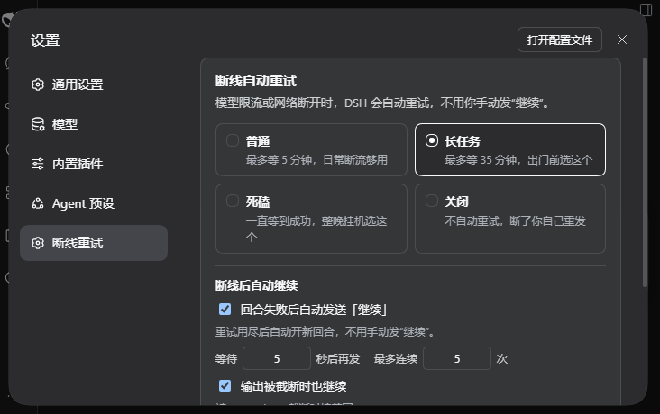

# dsh-auto-retry

> DeepSeek Harness（DSH）插件：设置里一张 **「断线重试」** 卡片。
> 请求级重试 + 回合级自动继续 + 同轮截断续写 + 压缩吞轮恢复 + 卡住看门狗。
>
> An auto-retry / auto-continue settings card for DeepSeek Harness: transient
> `429` / stream failures are retried inside the same turn where possible, and a
> failed turn can continue itself — with a circuit breaker, permanent-error
> classification and an idempotency guard.



---

## 它解决什么问题

长任务跑到一半，模型服务返回：

```json
429: {"code":"capacity_exceeded","message":"model capacity exceeded: tpm_exceeded"}
```

DSH 自带的 `dsh-llm-retry` 默认只重试 **5 次、总共约 16 秒**（500ms → 10s 退避）。
`tpm_exceeded` 要等分钟级窗口恢复，16 秒不够；重试耗尽后整轮失败，你回来只看到
「本轮运行失败」，还得自己发「继续」。

还有几种更隐蔽的断档：

- 输出被 `max-tokens` 截断，UI 提示「发送继续」；
- 流挂起，没有报错，界面一直转圈；
- 上下文压缩把整整一轮吞掉，`turn/end` 却是 `completed`，什么都没干就停了；
- 网关把瞬时 429 写成 `insufficient_quota`，被 DSH 归类成 `QUOTA`，内置重试直接放弃。

本插件把这几种情况都接住，并且尽量在**同一个回合内**恢复，而不是无脑新开一轮。

## 恢复顺序

### 1. 请求级重试（沿用 DSH 自带引擎）

把「耐心」写进每个 provider 的 `retryPolicy`，并显式补上容易漏掉的错误码。
覆盖两个写入点：`llm-pi-ai` 的每个 provider，以及 DeepSeek 官方 `llm-deepseek`
命名空间的顶层 `retryPolicy`。

```text
retryableCodes: EMPTY_RESPONSE, RATE_LIMIT, QUOTA, SERVER,
                TIMEOUT, TRANSPORT, PI_AI_ERROR, UNKNOWN
backoff:        1s 起、60s 封顶、±20% 抖动
```

| 选项 | 行为 | 适合 |
|---|---|---|
| 普通 | 最多重试 10 次，约 5 分钟 | 日常断流 |
| 长任务 | 最多重试 40 次，约 35 分钟 | 出门前挂任务 |
| 死磕 | `mode: always`，一直重试到成功 | 整晚挂机 |
| 关闭 | `maxRetries: 0` | 想自己控制 |

> 为什么要显式写 `QUOTA`：很多网关把瞬时 429 capacity/tpm 写成
> `insufficient_quota`，DSH 会归到 `QUOTA`；而内置默认集合里没有它，会一次都不重试。

### 2. 同轮截断续写（v0.3 新增）

`max-tokens` 截断时，在 `agent/turn-stopping` 阶段用 `agent.steer()` 注入一条
「继续写，从截断处接着输出」，让**同一个回合**继续，而不是结束后再开新回合。

- 单轮最多续写 3 次，避免模型无限复读；
- 达到上限就放行 `turn/end`，再由第 3 层跨轮兜底；
- 只有 `continueOnMaxTokens` 打开时才生效。

### 3. 回合级自动继续

一轮彻底失败后：

- 等 N 秒（默认 5 秒；连续失败按 2 倍逐步拉长，封顶 10 分钟）
- 以用户身份发送一条「继续」，开新回合，保留全部上下文
- 最多连续 N 次（默认 5 次），成功一轮清零
- **你手动发消息或点停止 → 立刻让位**
- 只对主智能体生效；子智能体是一次性任务，不自动继续
- 自己发的「继续」会被识别成回显，不误触发人工接管

**永久性错误不继续**：`AUTH` / `INVALID_CREDENTIAL` / `QUOTA` /
`CONTEXT_WINDOW_EXCEEDED` / `INVALID_REQUEST` / `UNKNOWN_MODEL` 等，
重试也救不回来，直接停下并记日志，避免拿额度空转。

**幂等护栏**：如果失败前最后一次工具调用没有结果（可能崩在 `git push`、
写文件、发消息的中间），自动继续的文本会附加一句「先确认外部状态再继续，
不要重复执行可能产生副作用的操作」。

### 4. 压缩吞轮恢复（v0.3 新增）

有些压缩事务会把一整轮吞掉：`turn/start → 压缩检查点 → turn/end(completed)`，
中间零 assistant 输出、零工具调用。插件识别这个形状后补一条
「按最近的检查点继续动手」，把被吞掉的活接回来。

### 额外：卡住看门狗（默认关闭）

打开后，如果一轮运行中超过 N 秒（默认 180 秒）没有任何流输出或事件：

- 主动取消当前请求（标记为 hook 取消）
- 交给回合级自动继续，保留上下文

> 超长工具调用 + 模型静默可能被误判；取消后会马上自动继续，不会丢上下文。

## 设置项

| 设置 | 默认 | 说明 |
|---|---|---|
| 重试耐心 | 普通 | 普通 / 长任务 / 死磕 / 关闭 |
| 回合失败后自动发送「继续」 | 开 | 回合级总开关 |
| 等待秒数 | 5 | 0~600；连续失败按 2 倍递增，封顶 10 分钟 |
| 最多连续 | 5 | 1~50 次，成功一轮清零 |
| 继续时发送 | 继续 | 支持 `{code}` `{kind}` `{attempt}` `{tool}` |
| 输出被截断时也继续 | 开 | 同轮续写 + 跨轮兜底 |
| 卡住不动时自动重来 | 关 | 看门狗总开关 |
| 卡住判定秒数 | 180 | 30~600 |

保存后立即生效，无需重启。

## 安装

按 DSH 的 bundle 方式安装（**不要**手写裸 `- id:`，那只覆盖已有条目，会报
`entry not found` 且整条被跳过）。

```sh
cd ~/.dsh/profiles/desktop        # 或 web
pnpm add github:Amer-CN/dsh-retry-panel
```

然后在同一个 `package.json` 的 `dsh.profile.bundles` 数组里加入包名：

```json
{
  "dsh": {
    "profile": {
      "bundles": [
        "@deepseek-ai/dsh-base",
        "@deepseek-ai/dsh-web-app",
        "dsh-auto-retry"
      ]
    }
  }
}
```

或者用 DSH 自带插件命令（若你的版本支持从 GitHub 安装）：

```sh
dsh plugin --profile desktop add github:Amer-CN/dsh-retry-panel
```

装完重启 / 重载 DSH。Web 端刷新页面，桌面端重新打开应用（或 F12 → Ctrl+R）。

## 它是怎么工作的

- **重试策略**：面板保存时先写本插件配置，再 `POST /api/auto-retry/apply`；
  Host 在独立 HTTP 任务里调用 `settings.mutate`，给 `llm-pi-ai` 的 provider
  和 `llm-deepseek` 顶层写入 `retryPolicy`。走独立路由是因为在
  `settings/document-updated` 里再写另一个条目会撞 `HMR transactions cannot be nested`。
- **自动继续**：监听 `session/event` 的 `turn/end`：
  - `error` 且非永久 → 排定继续
  - `max-tokens` → 跨轮兜底（同轮阶段优先）
  - `aborted` 且原因是 `hook`（看门狗自己取消）→ 开关打开时排定继续
  - 用户手动停止（`reason.kind === 'user'`）→ 永不自动继续
  到期后通过 `agent.followup()` 注入一条 `user` 消息，开新回合。
- **同轮续写**：记录 `agent/assistant-stream` 最后一个 `finish` 分片的
  `reason.kind`；`agent/turn-stopping` 时若还是 `max-tokens`，就 `agent.steer()`。
- **压缩吞轮**：按回合记录「是否有压缩检查点 / assistant 输出 / 工具调用」，
  `completed` 但只有检查点时判定为吞轮。
- **看门狗**：`agent/status`、`agent/assistant-stream`、`session/event` 都是活动
  信号；超时用 `agent.cancel({ kind: 'hook' })` 取消，再交给自动继续层。
- **熔断**：连续继续次数按会话记录，成功回合清零；人工输入会取消待发并暂停到
  下一次成功回合。

首次安装时，如果所有 provider 都还没有 `retryPolicy`，Host 会自动应用一次当前
档位；只要有一个 provider 已有自定义 `retryPolicy`，插件就**不会覆盖**。

## 兼容

- DSH `0.2.1-rc.3`（开发和实测版本）
- 需要 `settings` / `configEditor` 的 profile（desktop / web）；headless 下静默跳过
- 插件零外部运行时依赖（除 `@deepseek-ai/schemastery`）

## 边界

- 第 1 层只对「临时性」错误重试；`AUTH`、`QUOTA` 等永久错误不会无限重试
  （「死磕」档本身不限次数，请自行停止）
- 自动继续是「重开一轮」，不是「续写半个回答」；已提交的工具结果和上下文都保留
- 没有做模型故障转移（failover）；没有做宿主重启后的冷会话扫描；
  没有做弹窗 / 数据看板 —— 这些是同类插件的能力，本插件刻意保持「一张卡」

## 我们参考了谁

v0.3 前系统扫了 GitHub 上 40+ 个 DSH retry / auto-continue / failover / watchdog
项目，重点精读了 20+ 个。落地时参考了这些思路（实现独立，未复制代码）：

- [zxmqq1234/dsh-auto-retry](https://github.com/zxmqq1234/dsh-auto-retry) —— 回合级继续、熔断、看门狗、通知与看板
- [HsiangNianian/dsh-auto-continue](https://github.com/HsiangNianian/dsh-auto-continue) —— 错误分类、退避、静默回合、冷启动扫描、幂等护栏
- [Frog755/dsh-client-auto-retry](https://github.com/Frog755/dsh-client-auto-retry) —— 纯客户端自动「继续」、自身回显识别
- [hhb1028/dsh-retry-boost](https://github.com/hhb1028/dsh-retry-boost) —— `QUOTA` 被漏掉的问题、启动注入 retryPolicy
- [zmy15/dsh-plugin-retry-backoff](https://github.com/zmy15/dsh-plugin-retry-backoff) —— 自定义退避曲线、Retry-After
- [mengge237/dsh-auto-continue](https://github.com/mengge237/dsh-auto-continue) —— 压缩吞轮识别、max-tokens 续写
- [imcaibaicai/dsh-auto-continue-inturn](https://github.com/imcaibaicai/dsh-auto-continue-inturn) —— `agent/turn-stopping` + `agent.steer` 同轮续写
- [shu0819-sjy/dsh-auto-continue](https://github.com/shu0819-sjy/dsh-auto-continue) —— 双链熔断、防竞争围栏
- [Captain-OP2008/dsh-auto-continue](https://github.com/Captain-OP2008/dsh-auto-continue) —— 历史计数、跨重启上限
- [elanski/dsh-failover-continue](https://github.com/elanski/dsh-failover-continue) —— 自动继续 + 模型 failover、冷会话扫描

明确没做的：模型故障转移、宿主重启后的冷会话扫描、弹窗/看板、按错误码的自定义触发矩阵。
不是不会做，而是会把「一张卡」变成一套运维面板；需要再加。

## 开发

```sh
npm install
npm test
```

- `lib/index.js`：Host 侧。Config（8 个 volatile 字段）、首次安装写入、
  `/api/auto-retry/apply` 路由、自动继续 / 同轮续写 / 压缩恢复 / 看门狗状态机
- `lib/client.js`：浏览器侧。lazy-CJS 模块壳，注册 `settings.section`，渲染设置卡片
- `cordis.patch.yml`：bundle patch，只插入 `auto-retry` 一行
- `tests/`：不启动 DSH 的离线测试（服务端 29 项、客户端 10 项）

没有构建步骤；`lib/*.js` 就是发布产物。

## License

MIT
